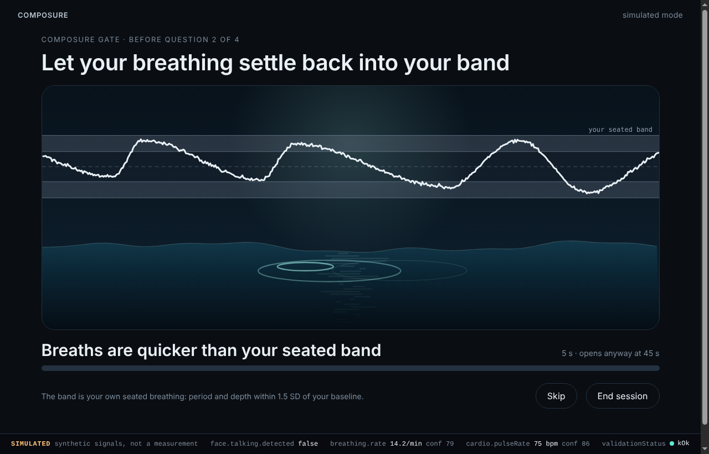
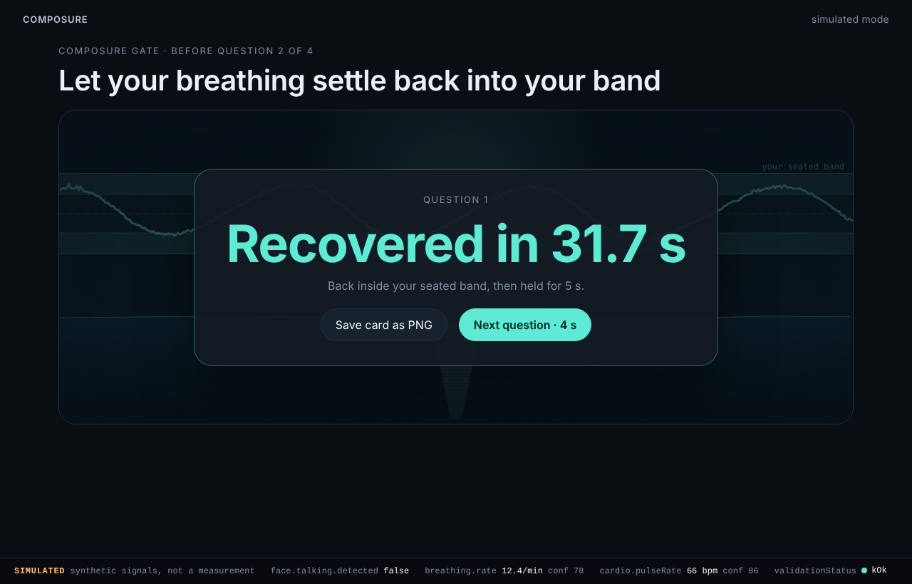
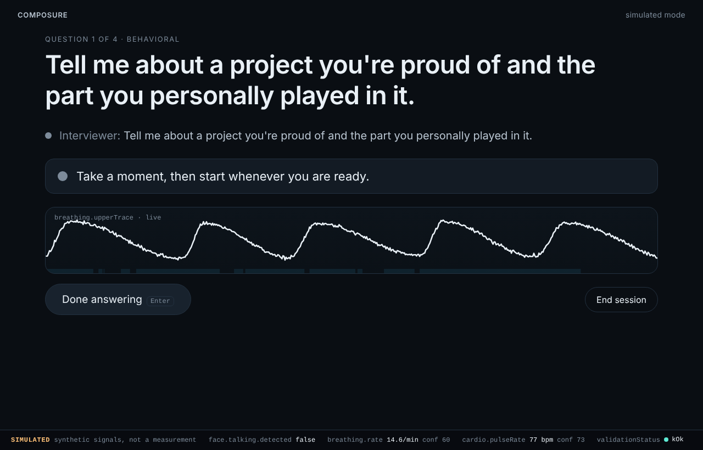
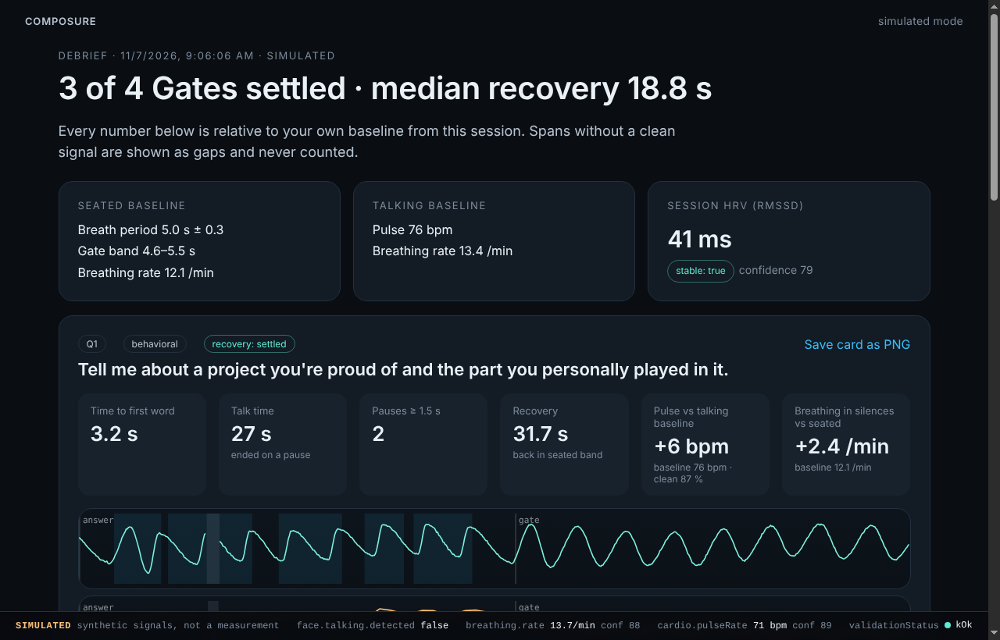
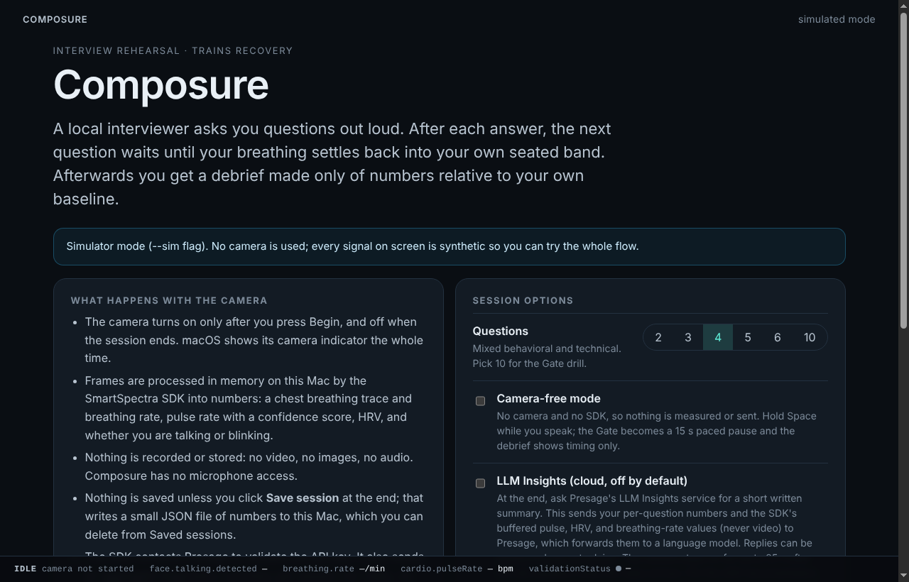
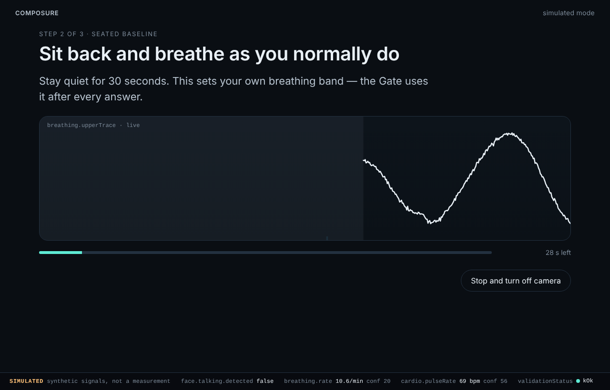

# Composure

**An interview rehearsal room that trains recovery, not just answers.**

A local text-to-speech interviewer asks you questions. Composure uses live
camera signals from the [SmartSpectra SDK](https://smartspectra.presagetech.com/)
(breathing trace and rate, pulse with confidence, HRV, talking detection) to:

1. **Run the interview hands-free.** Your answer starts when you start talking
   and ends after a pause, with no buttons.
2. **Give gentle live cues.** After a long mid-answer silence with breathing
   above your seated band, the interviewer says "Take your time." After 2½
   minutes of talking, it asks for a one-sentence summary.
3. **Gate the next question behind the Composure Gate.** After each answer,
   your live breathing trace has to settle back into your own seated band
   (period and depth within 1.5 SD) and stay there for 5 seconds. A water
   surface stills as you settle. The Gate opens anyway at 45 s.
4. **Give an honest debrief.** Per question: time to first word, talk time,
   pauses, recovery time, pulse change against your talking baseline (only with
   ≥ 60 % clean signal), and breathing change in silences against your seated
   baseline. Every number is relative to your own baseline, and spans without
   a clean signal are gaps, never numbers.

Everything runs on your Mac. No video, images, or audio are ever stored. It is
a rehearsal tool, not a medical device. See [CONSENT_AND_DATA.md](CONSENT_AND_DATA.md).

## Screenshots

> Placeholders. The images in `docs/screenshots/` were captured in
> **simulator mode** (synthetic signals, labelled SIMULATED in the HUD). Replace
> them with real-camera captures for the submission.

| Gate (settling) | Gate (unlocked) |
| --- | --- |
|  |  |
| **Interview** | **Debrief** |
|  |  |
| **Consent** | **Seated baseline** |
|  |  |

## Setup

Requirements: macOS on Apple Silicon (the SmartSpectra runtime for macOS is
arm64 only), **Node 24 LTS** (Node ≥ 20 works), and a SmartSpectra API key from
[physiology.presagetech.com](https://physiology.presagetech.com/).

```bash
npm install
```

`npm install` downloads the SmartSpectra native runtime for every supported
platform (a few hundred MB); only the one for your machine is loaded.

```bash
export PRESAGE_API_KEY=your-key-here
```

```bash
npm run dev
```

```bash
npm run dev -- --sim
```

The first launch in real mode shows the macOS camera prompt. Grant it to
Electron (dev) or Composure (packaged).

### How real vs simulator mode is selected

Decided once at startup in `src/main/cli.ts`:

| Situation | Mode |
| --- | --- |
| `--replay=<file>` passed | Replay of a recorded signal file |
| `--sim` passed | Simulator |
| `PRESAGE_API_KEY` (or `SMARTSPECTRA_API_KEY`) not set | Simulator |
| Otherwise | Real mode: SmartSpectra SDK + camera |

The HUD strip along the bottom of every screen always says which mode is running
(`SDK LIVE`, `SIMULATED`, `REPLAY`, or `CAMERA OFF`). The consent screen also
offers **camera-free mode**: no camera and no SDK. You hold Space while you
speak, the Gate becomes a 15 s paced pause, and the debrief shows timing only.

Simulator options (all optional):

```bash
npm run dev -- --sim --sim-seed=7 --sim-speed=4 --sim-scenario=demo
```

Scenarios: `demo` (warm-up, a hard question with a long silence that triggers
"Take your time.", a low-signal answer, a slow settle that times out, a long
answer), `full` (all behaviors early, including the 2:30 cut-in on question 2),
`steady`, `timeout`, `cueB`. `--sim-speed` compresses time for quick
walkthroughs.

Tuning without rebuilding:

```bash
npm run dev -- --config=my-tuning.json
```

where `my-tuning.json` is any subset of `src/engine/config.ts`, for example
`{ "gate": { "bandSdMultiplier": 2, "holdMs": 4000 } }`.

## Record a real session for replay

```bash
npm run dev -- --record
```

Run a session; on the debrief click **Save signal recording**. The file holds
only the normalized numbers the engine saw (breathing trace and rate, pulse and
confidence, talking, blinking, HRV, validation statuses), with no frames.
Replay it:

```bash
npm run dev -- --replay=/path/to/composure-recording-123.json
```

To turn a recording into a regression test, copy it into `fixtures/replays/`
and follow the pattern in `tests/replay.test.ts` (see MORNING_CHECKLIST.md).

## Tests and checks

```bash
npm test
```

```bash
npm run lint
```

```bash
node scripts/smoke-sim.mjs --full --speed=8
```

```bash
node scripts/headless-check.mjs
```

- `npm test`: vitest suites for the state machine (arming, cues A/B, Gate unlock
  vs timeout), metrics on synthetic traces with known answers, the Gate
  detector, the simulator, record/replay, a full simulated session through the
  engine to a debrief JSON, a replay fixture that must reproduce its debrief
  exactly, a banned-words scan of every source and doc file, and architecture
  rules (pure engine; SDK imports only where allowed).
- `npm run lint`: oxlint plus TypeScript, including a no-DOM, no-Node
  typecheck of `src/engine`.
- `scripts/smoke-sim.mjs` launches the Electron app and drives it over the
  Chrome DevTools Protocol (needs Playwright; under Xvfb on headless Linux).
  `--full` goes consent → debrief → save → saved sessions → delete;
  `--camera-free` runs a camera-free session; `--real` exercises real mode
  with Chromium's fake camera.
- `scripts/headless-check.mjs` runs the SmartSpectra SDK in plain Node with
  synthetic frames (`useCustomInput()`/`sendFrame()`), or a clip with
  `--video=clip.mp4`.
- `scripts/session-report.mjs` summarizes saved sessions (Gate outcomes, what
  kept each Gate closed, pulse coverage) for tuning.

## Packaging (macOS)

```bash
npm run make
```

Builds a zip of `Composure.app` on an Apple Silicon Mac. `forge.config.mts`
ships the SmartSpectra runtime as an extra resource
(`Contents/Resources/node-sdk-darwin-arm64/`), copies the SDK's JS into the
app, and sets `NSCameraUsageDescription`. Signing is opt-in with
`COMPOSURE_SIGN_IDENTITY` (hardened runtime + `build/entitlements.mac.plist`).
Packaging is native-only; build the Mac app on a Mac.

## How it is built

```
src/engine/    pure TypeScript: state machine, Gate detector, breath-cycle
               detector, baselines, cues, debrief metrics, session JSON,
               config.ts (every tunable constant)
src/signals/   SignalSource interface; PresageSignalSource (the only renderer
               file that calls the SDK), SimulatedSignalSource, ReplaySignalSource,
               ManualSignalSource (camera-free), recordToJson tap
src/main/      Electron main: mode selection, IPC, session store, SDK binding
src/preload/   window.composure bridge + the SDK's preload bridge
src/renderer/  React UI: screens, HUD, Gate water surface, charts, PNG card
```

See [CLAUDE.md](CLAUDE.md) for conventions, [DECISIONS.md](DECISIONS.md) for
every non-obvious choice, [STATUS.md](STATUS.md) for what is and isn't verified,
and [docs/SDK_NOTES.md](docs/SDK_NOTES.md) for the SDK facts this build relies on.

## License

MIT for Composure's own code. The SmartSpectra SDK is licensed separately by
Presage Technologies (see `node_modules/@smartspectra/node-sdk/LICENSE`).
